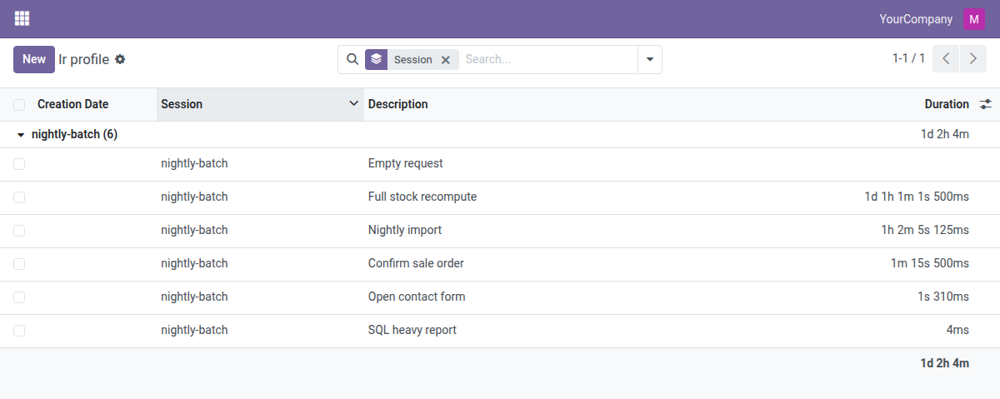

# Odoo Widgets

**Readable data in the Odoo backend, one small module at a time.**

A growing collection of independent addons for the Odoo web client: field widgets, view
enhancements and helpers that show stored values the way people actually read them.

Odoo series: [17.0](https://github.com/TesaLazarenko/odoo_widgets/tree/17.0) · [18.0](https://github.com/TesaLazarenko/odoo_widgets/tree/18.0) · **19.0** · [20.0](https://github.com/TesaLazarenko/odoo_widgets/tree/20.0)

## Principles

- **One module, one job.** Every module solves a single problem and installs on its own, so you
  add exactly what you need.
- **Built on standard Odoo.** Modules extend the core web client instead of replacing it, depend
  only on `web` or other core apps and add no models unless a feature needs one.
- **Every supported series.** Each branch matches an Odoo series, from `17.0` to `20.0`: clone
  the one you run and add it to `addons_path` as is.
- **Tested and documented.** Each module ships with Python and JavaScript tests, translations,
  a README and an Apps page with screenshots.

## Modules

| | Module | Technical name | Topic | What it does | Version |
|-|--------|----------------|-------|--------------|---------|
| ⏱️ | [Duration Widget](#web_widget_duration) | `web_widget_duration` | Field widgets | Seconds shown as `1d 1h 1m 1s 500ms`, with readable sums | `19.0.1.1.0` |

### Field widgets

#### ⏱️ Duration Widget · [`web_widget_duration`](web_widget_duration)

Durations stored as seconds read as `1d 1h 1m 1s 500ms` instead of `90,061.50`, in forms, lists, kanban, pivot and graph.

**Use it:** `widget="human_duration"` on `float` or `integer` fields that hold seconds · **Depends on:** `web` · [Module README](web_widget_duration/README.rst)

- **Precision you choose.** `max_units` and `min_unit` cut the tail; `min_unit: 'auto'` picks it from the size: `1d 1h 1m`, `1h 2m 5s`, `59.6s`.
- **Readable sums.** List group rows and totals, pivot and graph show `1d 2h 6m`, not a wall of units.
- **Translated.** Unit symbols in Ukrainian, German and Polish; the decimal separator follows the user's language.

Screenshot

## License

[LGPL-3.0](LICENSE). Every module states its license in `__manifest__.py`.
